# Academic Project Report: Explainable AI Diabetes Prediction & Clinical Decision Support System

**Project Type:** Final-Year Undergraduate / Graduate Capstone Research Project  
**Domain:** Healthcare Informatics & Explainable Artificial Intelligence (XAI)  
**System Classification:** Non-Diagnostic Clinical Decision Support Prototype  
**Date:** September 2026  
**Status:** Fully Implemented, Calibrated, and Empirically Verified (45 Automated Tests Passing)

---

## Executive Summary

Machine learning (ML) models in healthcare often suffer from the "black-box" dilemma: while ensemble tree models such as XGBoost achieve strong discrimination, their opaque decision-making limits clinical trust, physician adoption, and patient understanding. 

This project develops a comprehensive, clinically grounded, and trust-oriented **Explainable AI Diabetes Prediction System**. Built upon the PIMA Indians Diabetes Dataset ($N=768$, 8 numerical clinical features), the system transforms binary statistical classification into transparent clinical decision support. 

Key innovations and accomplishments include:
1. **Calibrated Machine Learning Core**: Preserved the exact baseline XGBoost model (Holdout ROC-AUC $0.8198$, Accuracy $74.03\%$) while building an optimized, probability-calibrated model that increases recall on the diabetic class from **$55.56\%$ to $81.48\%$**, slashing missed diabetic cases (False Negatives) by more than half.
2. **Dual Local Explainability (SHAP + LIME)**: Combines game-theoretic local Shapley attributions (TreeExplainer) with local surrogate approximations (LIME), validated by quantitative agreement metrics (Spearman rank correlation $\rho = 0.8810$, Top-3 feature overlap $100\%$, sign concordance $100\%$).
3. **Personalized SHAP-Based Recommendation Engine**: A deterministic clinical guidance engine that maps patient inputs and positive (upward) SHAP risk drivers into tailored, evidence-based lifestyle and screening recommendations. The engine strictly enforces non-diagnostic medical guardrails, distinguishes modifiable from non-modifiable factors, avoids crash diet advice, and prevents prescriptive medication commands.
4. **Demographic Metadata Isolation & Gender-Conditional UI**: Integrates **Patient Name**, **Age**, and **Biological Sex** as report metadata without polluting the 8-feature ML feature matrix. Automatically sets pregnancies to `0` and disables the widget when biological male sex is selected.
5. **Multi-Channel Delivery Layer**:
   - **Streamlit Web Application**: An interactive 7-tab interface featuring real-time risk classification, sensitivity sweeps, and perturbation robustness evaluations.
   - **ReportLab PDF Generator**: Compiles an academic-grade 9-section clinical assessment document with embedded SHAP visualizations and mandatory disclaimers.
   - **Secure SMTP Email Service**: Dispatches RFC 5322-compliant clinical summaries and PDF attachments with TLS security.
   - **Grounded LLM Synthesis**: Connects to Google Gemini (`gemini-flash-lite-latest`) with a 100% deterministic fallback engine for complete offline availability.

---

## 1. Introduction & Clinical Motivation

### 1.1 The Clinical Challenge of Diabetes Mellitus
Type 2 diabetes mellitus is a chronic metabolic condition characterized by insulin resistance and relative insulin deficiency. Because its early stages are frequently asymptomatic, early screening is vital to prevent microvascular and macrovascular complications, including nephropathy, retinopathy, neuropathy, and cardiovascular disease.

### 1.2 The "Black Box" Problem in Clinical AI
Standard deep learning and ensemble models output raw probabilities without explaining the underlying rationale. In clinical environments, a physician cannot responsibly act on an unexplained probability. Furthermore, generic lifestyle advice fails to engage patients because it ignores which specific physiological factors contributed to their elevated risk.

### 1.3 Scope and Regulatory Guardrails
This system is an **academic research prototype designed for educational decision support**. It is **strictly non-diagnostic**:
- It does not diagnose diabetes or prediabetes.
- It does not prescribe, adjust, or recommend any medications or insulin therapy.
- It does not treat statistical SHAP attributions as biological causation.
- Every report and screen prominently displays mandatory clinical disclaimers.

---

## 2. End-to-End System Architecture

The following diagram illustrates the information flow from raw patient input to multi-channel delivery:

```mermaid
flowchart TD
    subgraph UI ["User Interface (Streamlit 7-Tab App)"]
        InName["Patient Name (Metadata)"]
        InSex["Sex: Female / Male / Unspecified (Metadata)"]
        InAge["Patient Age (Years)"]
        InPreg["Pregnancies (0 if Male)"]
        InPhysio["Glucose, BP, Skin, Insulin, BMI, DPF"]
    end

    subgraph Preproc ["Preprocessing Pipeline (Leak-Free)"]
        ZeroCheck["MissingZeroHandler (Zeros -> NaN)"]
        Impute["Median Imputer (models/imputer.pkl)"]
        Scale["StandardScaler (models/scaler.pkl)"]
    end

    subgraph Modeling ["Machine Learning Inference"]
        Model["XGBoost Classifier (Baseline / Calibrated)"]
        Pred["Prediction Class (0 / 1)"]
        Prob["Calibrated Probability (tau = 0.50)"]
    end

    subgraph XAI ["Dual Explainability Engine"]
        TreeSHAP["SHAP TreeExplainer (Signed Log-Odds Shifts)"]
        LIME["LIME Tabular Explainer (Local Surrogate)"]
        Agree["Agreement Analysis (Spearman rho, Jaccard Overlap)"]
    end

    subgraph RecEngine ["Deterministic Recommendation Engine"]
        UpwardDrivers["Identify Strongest Positive SHAP Drivers"]
        ModRules["Modifiable vs Non-Modifiable Rules"]
        SafetyCheck["Enforce Clinical & Medical Guardrails"]
    end

    subgraph Delivery ["Multi-Channel Delivery Layer"]
        StreamlitUI["Tab 1 & Tab 5 UI Accordions"]
        PDFGen["9-Section ReportLab PDF Report"]
        EmailService["TLS SMTP Email Dispatch with Attachment"]
        LLM["Google Gemini Grounded Narrative (or Fallback)"]
    end

    UI --> Preproc
    Preproc --> Modeling
    Modeling --> XAI
    Modeling --> RecEngine
    XAI --> RecEngine
    RecEngine --> Delivery
```



---

## 3. Dataset & Preprocessing Pipeline

### 3.1 Dataset Profile: PIMA Indians Diabetes Database
- **Total Records**: 768 patient profiles.
- **Target Variable**: `Outcome` (Binary: 0 = Non-diabetic, 1 = Diabetic; prevalence $\approx 34.9\%$).
- **Features**: 8 clinical measurements:
  1. `Pregnancies`: Number of times pregnant.
  2. `Glucose`: Plasma glucose concentration at 2 hours in an oral glucose tolerance test (mg/dL).
  3. `BloodPressure`: Diastolic blood pressure (mmHg).
  4. `SkinThickness`: Triceps skin fold thickness (mm).
  5. `Insulin`: 2-Hour serum insulin ($\mu\text{U/mL}$).
  6. `BMI`: Body mass index ($\text{kg/m}^2$).
  7. `DiabetesPedigreeFunction`: Genetic predisposition score based on family history.
  8. `Age`: Age in completed years.

### 3.2 Physiological Zero Handling
In human physiology, measurements of `Glucose`, `BloodPressure`, `SkinThickness`, `Insulin`, and `BMI` cannot physically equal zero in living subjects. A value of $0$ indicates unrecorded or missing data:
- `MissingZeroHandler` dynamically maps zeros in these 5 features to `np.nan`.
- `Pregnancies` correctly permits $0$ as a biologically valid count.

### 3.3 Leak-Free Train/Test Splitting
- Split ratio: $80\%$ Training ($N=614$), $20\%$ Holdout Testing ($N=154$).
- Stratification applied to preserve class proportions ($34.9\%$ diabetic across both sets).
- **Zero Data Leakage**: The `SimpleImputer` (median strategy) and `StandardScaler` were fitted **strictly on the training split** and persisted as serialized artifacts (`models/imputer.pkl` and `models/scaler.pkl`). Holdout data and user inputs are transformed using these pre-fitted parameters.

---

## 4. Machine Learning Modeling & Benchmarking

### 4.1 Multi-Model Empirical Benchmark
Five candidate algorithms were benchmarked under 5-Fold Stratified Cross-Validation using identical leak-free preprocessing pipelines:

| Algorithm | Mean CV ROC-AUC | Mean CV Accuracy | Mean CV Recall | Mean CV F1 |
|:---|:---:|:---:|:---:|:---:|
| **XGBoost (Baseline)** | **0.8322** ($\pm 0.0237$) | $75.89\%$ | $60.29\%$ | $63.81\%$ |
| **XGBoost (Optimized)** | **0.8430** ($\pm 0.0195$) | $76.87\%$ | $67.28\%$ | $67.42\%$ |
| **LightGBM** | $0.8315$ ($\pm 0.0210$) | $75.40\%$ | $62.15\%$ | $64.10\%$ |
| **Random Forest** | $0.8290$ ($\pm 0.0245$) | $75.24\%$ | $58.88\%$ | $62.40\%$ |
| **Logistic Regression** | $0.8265$ ($\pm 0.0220$) | $76.22\%$ | $56.54\%$ | $62.50\%$ |

### 4.2 Baseline vs. Calibrated Holdout Evaluation ($N=154$)
In clinical diabetes screening, a **False Negative** (missing a diabetic patient) carries severe health risks, whereas a False Positive triggers low-risk confirmatory laboratory testing. Therefore, high recall and calibrated probabilities take precedence over raw accuracy:

| Evaluation Metric | Baseline XGBoost | Optimized XGBoost | Calibrated XGBoost ($\tau=0.30$) |
|:---|:---:|:---:|:---:|
| **Accuracy** | $74.03\%$ | $73.38\%$ | **$75.32\%$** |
| **Recall (Sensitivity)** | $55.56\%$ ($30/54$) | **$83.33\%$** ($45/54$) | **$81.48\%$** ($44/54$) |
| **Precision** | **$65.22\%$** | $58.44\%$ | $61.11\%$ |
| **F1-Score** | $60.00\%$ | $68.70\%$ | **$69.84\%$** |
| **F2-Score (Recall Weighted)** | $57.25\%$ | **$76.79\%$** | $76.39\%$ |
| **ROC-AUC** | $0.8198$ | $0.8243$ | **$0.8310$** |
| **PR-AUC** | $0.6751$ | $0.6918$ | **$0.7009$** |
| **Brier Score (Calibration)** | $0.1812$ | $0.1745$ | **$0.1670$** (Lowest error) |
| **False Negatives (Missed Cases)** | **24** | **9** ($-62.5\%$) | **10** ($-58.3\%$) |
| **False Positives** | 16 | 32 | 28 |

---

## 5. Dual Local Explainability (SHAP vs. LIME)

To ensure reliable, multi-angle model transparency, the system provides dual local explainability:

### 5.1 Game-Theoretic SHAP (TreeExplainer)
- Uses cooperative game theory (Shapley values) to compute exact feature attributions for tree ensembles.
- Explains the log-odds shift from the base expected cohort value $E[f(x)] = -0.669$ to the individual patient's score $f(x)$.
- **Directional Interpretation**:
  - **Positive SHAP ($> 0$)**: Pushes the model prediction toward the diabetes-positive class (elevated risk).
  - **Negative SHAP ($< 0$)**: Pushes the model prediction toward the diabetes-negative class (lower risk).

### 5.2 Local Interpretable Model-agnostic Explanations (LIME)
- Fits an interpretable sparse linear surrogate model locally around the patient's perturbed neighborhood.
- Provides rule-based thresholds (e.g., $\text{Glucose} > 125.0 \implies \text{Weight } +0.38$).

### 5.3 Explanation Concordance Analysis
Empirical evaluation of explanation consistency on the holdout test set demonstrated remarkable agreement:
- **Spearman Rank Correlation**: $\rho = 0.8810$ ($p = 0.0039$), demonstrating strong monotonic alignment between SHAP and LIME rankings.
- **Top-3 Feature Overlap (Jaccard Index)**: $1.00$ ($100\%$), indicating identical identification of the top 3 critical drivers.
- **Sign Concordance**: $100\%$, confirming that both methods agree on whether a feature elevated or lowered predicted risk.

---

## 6. Personalized SHAP-Based Recommendation Engine

Unlike generic systems that output the same static bullet points for every patient, this system features a **dynamic, deterministic educational recommendation engine** ([`services/recommendations.py`](file:///d:/Downloads/Explainable-AI-Diabetes%20-%20Copy/services/recommendations.py)).

### 6.1 Core Personalization Rules
1. **Dynamic Selection by SHAP Drivers**:
   - The engine analyzes the patient's signed local SHAP vector.
   - It filters and sorts features with positive SHAP values in descending order of influence.
   - Specific educational guidance is generated **only for features actively pushing predicted risk higher**.
2. **Negative Contributor Framing**:
   - Negative SHAP features are described as having *"lowered the model's predicted risk for this particular assessment"*.
   - They are **never** described as "medically protective".
3. **Modifiable vs. Non-Modifiable Feature Classification**:

| Clinical Parameter | Classification | Model Context & Educational Guidance | Guardrail Constraints |
|:---|:---:|:---|:---|
| **Glucose** | Modifiable | Strongest risk factor; recommends discussing fasting plasma glucose and HbA1c testing with a physician; encourages complex carbohydrates, whole grains, vegetables, and limiting refined sugars. | Never advise altering insulin or diabetic medication independently. |
| **BMI** | Modifiable | Highlights weight and body composition; encourages sustainable, balanced nutrition and regular physical activity tailored to personal fitness. | Strictly avoid crash diets. Never promise that losing $X\text{ kg}$ will lower model probability by $Y\%$. |
| **Blood Pressure** | Modifiable | Recommends resting blood pressure monitoring, physician consultation if elevated, and sodium reduction. | Explicitly clarify that a single reading is not a clinical diagnosis of hypertension. |
| **Insulin** | Modifiable | Explains insulin's role as a predictive model input; suggests comprehensive clinical metabolic evaluation. | Do not infer insulin resistance solely from model; no medication adjustments without a physician. |
| **Age** | **Non-Modifiable** | Explains that age is a historical, non-modifiable risk contributor; suggests age-appropriate health screenings and low-impact exercise. | **Never recommend "reducing age" or altering age-related values.** |
| **Pregnancies** | **Non-Modifiable** | Historical obstetric input; focuses on ongoing preventive metabolic vigilance. | Cannot be changed; focuses purely on general health. |
| **Diabetes Pedigree Function** | **Non-Modifiable** | Genetic family history score; emphasizes family history awareness and sharing information with primary care physicians. | Cannot be modified; emphasizes proactive preventive resilience. |
| **Skin Thickness** | Modifiable Proxy | Anthropometric composition marker; non-diagnostic model input. | No medical diagnosis inferred from skinfold alone. |

---

## 7. Demographic Metadata Handling & UI Logic

### 7.1 Separation of Demographics from the ML Feature Matrix
The PIMA Indians Diabetes Dataset was collected from female patients and does not include `Sex` or `Name` as predictive variables. 

To maintain mathematical validity and prevent retraining errors:
- `FEATURE_ORDER` is strictly locked to the 8 physiological features:
  ```python
  FEATURE_ORDER = [
      "Pregnancies", "Glucose", "BloodPressure", "SkinThickness",
      "Insulin", "BMI", "DiabetesPedigreeFunction", "Age"
  ]
  ```
- **Neither Patient Name nor Sex is ever passed to the XGBoost model, imputer, or scaler.**
- **No SHAP values are calculated for Name or Sex.**

### 7.2 Gender-Conditional Input Logic
In [`app.py`](file:///d:/Downloads/Explainable-AI-Diabetes%20-%20Copy/app.py):
- **Patient Full Name**: Text input defaulting to `"Not Provided"` if left blank.
- **Sex**: Dropdown menu offering:
  1. `Female`
  2. `Male`
  3. `Not specified / Prefer not to say`
- **Dynamic Reactivity**: When `Male` is selected:
  - `Pregnancies` automatically defaults to **`0`**.
  - The input number widget is **locked and disabled** (`disabled=True`) with an explanatory tooltip.
  - When switching back to `Female` or `Not specified`, `Pregnancies` unlocks and accepts input ($0$ to $20$).

---

## 8. Multi-Channel Reporting & Service Layer

The project provides four unified delivery channels, all driven by the shared recommendation engine:

### 8.1 7-Tab Streamlit Application (`app.py`)
- **Tab 1 (Patient Prediction)**: Clinical input form, input validation, probability gauge, top-3 SHAP cards, and interactive **Personalized Guidance** expander cards.
- **Tab 2 (Why This Prediction?)**: Full SHAP waterfall bar chart, LIME linear surrogate breakdown, and agreement metrics.
- **Tab 3 (Model Performance)**: Benchmark comparison table, interactive decision threshold slider ($\tau \in [0.30, 0.70]$), ROC curves, and confusion matrix.
- **Tab 4 (Sensitivity & Robustness)**: Interactive 1-D feature sweeps and real-time $\pm 2\%$ Gaussian noise perturbation test.
- **Tab 5 (AI Patient Report)**: Service status monitor, clinical report narrative preview, 9-section PDF download, and SMTP email dispatch form.
- **Tab 6 (About & Trust Framework)**: Pipeline diagram and 6-dimension empirical trust evaluation framework.
- **Tab 7 (Project Limitations)**: Non-diagnostic boundaries, population bias disclosures, and ethical constraints.

### 8.2 Structured 9-Section PDF Report (`services/pdf_report.py`)
Generates a 2-page clinical document formatted with ReportLab:
1. **Patient Information**: 2-column demographic card (Name, Age in years, Sex, Assessment Date).
2. **Clinical Measurements**: Structured table of physiological parameters.
3. **Risk Assessment**: Color-coded risk banner, probability, $50\%$ decision threshold, model name, and holdout ROC-AUC.
4. **Top Influential Factors**: Local SHAP table with explicit directional impact language (*"Pushes model prediction toward diabetes-positive class"*) and embedded chart.
5. **Personalized Model-Based Summary**: Narrative overview and **Highest-Priority Areas** breakdown.
6. **Personalized Educational Guidance & Wellness Recommendations**: Tailored educational bullets for upward drivers.
7. **General Preventive Wellness Guidance**: Standard metabolic and lifestyle recommendations.
8. **AI Natural Language Synthesis**: Grounded clinical narrative.
9. **Important Limitations & Disclaimer**: Prominent boxed mandatory medical disclaimer.

### 8.3 Secure SMTP Email Dispatcher (`services/email_service.py`)
- Strictly validated against RFC 5322 syntax.
- Connects securely via TLS/STARTTLS (`smtp.gmail.com:587`).
- Dispatches plain-text summaries (including demographics, risk probability, key SHAP drivers, and personalized guidance) with the generated PDF attached.
- Never fakes delivery: returns verified boolean delivery statuses.

### 8.4 Grounded LLM Synthesis (`services/ai_report.py`)
- Communicates with Google Gemini (`gemini-flash-lite-latest`) or OpenAI (`gpt-4o-mini`).
- Strict grounding prompts prevent hallucinated lab tests, medications, or diagnoses.
- **100% Deterministic Fallback**: If an API key is missing or internet is down, seamlessly generates the full clinical report using the deterministic rule-based template.

---

## 9. Empirical Validation & Stability Testing

### 9.1 Local Perturbation Robustness Testing
To ensure the model is clinically stable and not brittle to minor sensor or measurement noise, [`src/stability.py`](file:///d:/Downloads/Explainable-AI-Diabetes%20-%20Copy/src/stability.py) applies 50 iterations of $\pm 2\%$ Gaussian noise across all 8 features:
- **Prediction Flip Rate**: **$0.00\%$** (zero category flips across tested typical profiles).
- **Probability Standard Deviation ($\sigma$)**: $0.0084$ (exceptionally low variance under noise).
- **Normalized Robustness Index**: **$1.000 / 1.000$** (indicates robust, resilient local decision topology).

### 9.2 One-At-A-Time (OAT) Sensitivity Sweeps
Implemented in [`src/faithfulness.py`](file:///d:/Downloads/Explainable-AI-Diabetes%20-%20Copy/src/faithfulness.py) to sweep individual features across physiological percentiles ($1^\text{st}$ to $99^\text{th}$):
- Confirms the piecewise step-function nature of decision tree splits.
- Documents threshold points (e.g., steep probability climbs when fasting glucose surpasses $\approx 127\text{ mg/dL}$).

---

## 10. Automated Test Suite Validation

The project includes an extensive automated test suite executed via Python's `unittest` framework. All **45 automated tests pass with 100% success**:

```powershell
.\venv\Scripts\python.exe -m unittest discover -s tests
```
```text
.............................................
----------------------------------------------------------------------
Ran 45 tests in 5.705s

OK (100% Passing)
```

### Breakdown of Test Coverage
1. **`tests/test_personalized_guidance.py` (15 Tests)**:
   - Patient Name, Age, and Sex verified in decompressed PDF text streams.
   - Positive Glucose and BMI SHAP verified to generate specific guidance.
   - Positive Age SHAP verified to never recommend "reducing age".
   - Negative Insulin SHAP verified to never recommend "reducing insulin".
   - Negative SHAP verified to never be called "medically protective".
   - Name and Sex verified to be absent from `FEATURE_ORDER`.
   - Shared recommendation function verified between UI, PDF, and Email.
   - Offline PDF compilation verified without an LLM key.
   - Absence of prescriptive medication commands verified.
   - Presence of mandatory medical disclaimers verified.
2. **`tests/test_email.py` (6 Tests)**: RFC 5322 validation, SMTP status checks, body formatting, and test email delivery.
3. **`tests/test_reports.py` (4 Tests)**: LLM status checks, 12-section fallback generation, and PDF compilation.
4. **`tests/test_explainability.py` (6 Tests)**: SHAP TreeExplainer, LIME surrogate, agreement metrics, and perturbation robustness.
5. **`tests/test_preprocessing.py` (5 Tests)**: `MissingZeroHandler`, median imputation, and z-score standard scaling.
6. **`tests/test_models.py` (5 Tests)**: Baseline holdout metrics, optimized artifact loading, and confusion matrix verification.
7. **`tests/test_validation.py` (4 Tests)**: Domain boundary enforcement, physiological range checks, and error formatting.

---

## 11. Ethical Considerations & Project Limitations

1. **Cohort & Demographic Bias**: The training data originates exclusively from female Pima Indian patients aged $\ge 21$. Caution must be exercised when generalizing findings to diverse ethnic cohorts or pediatric populations.
2. **Imputation Variance**: Unrecorded physiological parameters are imputed using training cohort medians. While standard in clinical informatics, this may reduce extreme variance for patients with severe acute presentations.
3. **Non-Causality of SHAP Attributions**: Feature attributions describe statistical reliance within the tree ensemble, **not** direct biological causation. Modifying a lifestyle factor cannot guarantee an identical numerical reduction in model probability.
4. **Regulatory Non-Diagnostic Boundary**: This system is not an FDA-cleared software as a medical device (SaMD). It is intended purely for research, screening decision support, and patient education.

---

## 12. Conclusion & Future Roadmap

This project successfully upgrades a basic diabetes prediction script into an academic-grade, publication-ready Explainable AI decision-support system. By combining probability calibration, dual local explanations (SHAP + LIME), quantitative agreement metrics, personalized educational guidance, demographic metadata isolation, and automated multi-channel reporting, the system establishes a complete framework for transparent clinical AI.

### Future Work
- **External Multi-Cohort Validation**: Evaluating the calibrated pipeline on larger, ethnically diverse datasets (e.g., NHANES or UK Biobank).
- **Longitudinal Trajectory Modeling**: Extending single-point predictions to sequential time-series monitoring.
- **FHIR / HL7 Integration**: Formatting generated reports into standard HL7 Fast Healthcare Interoperability Resources (FHIR) bundles for seamless EHR integration.
